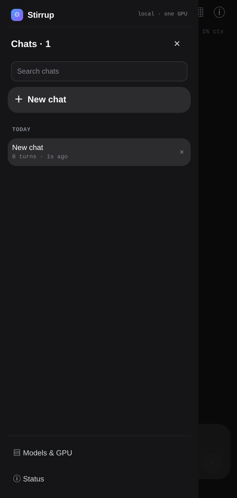

# Stirrup — a local LLM harness on an 8 GB laptop + a phone

A phone-first harness for local llama.cpp models: model switching, an agent with real tools, MCP,
voice, model downloads and synced chat history — all on one laptop, with no cloud inference.

**Public writeup:** <https://trutto.github.io/stirrup/>

> **What's in this repo:** the public write-up, architecture and setup guide. The reference
> harness (`scripts/harness.py`, `scripts/ui.html`, `serve-local.sh`, the Android shell) is a
> personal implementation and is **not included** here; model files and llama.cpp binaries are
> also not included. The sections below document the design, configuration and commands needed to
> build or adapt the same stack.



## The constraint

This was built around one hard rule:

> On 8 GB of VRAM, only one model can live on the GPU at a time. Everything else is a trade.

Hardware used for the numbers below:

| | |
|---|---|
| GPU | NVIDIA RTX 5050 Laptop, **8 GB VRAM** |
| CPU | Intel Core 7 240H |
| RAM | **16 GB** (32 GB planned) |
| OS | Arch Linux / Omarchy, Hyprland |
| Phone | Android, Tailscale, PWA or a tiny WebView shell |

The design goal is not "run the biggest benchmark model". It is "run the best model that actually
fits, keep it fast, and make the phone experience feel native".

## Architecture

```
┌──────────────────────────────┐
│ Phone                        │
│ PWA / Android WebView        │
│ chat · trajectory · models   │
│ history · approvals · voice  │
└──────────────┬───────────────┘
               │ Tailscale (WireGuard, private tailnet)
               ▼
┌──────────────────────────────┐
│ Laptop · Stirrup harness     │
│ :8090 UI + JSON API + SSE    │
│ session store · model manager│
│ agent loop · tool registry   │
│ compaction · auto-think      │
└──────────────┬───────────────┘
               │ localhost, one model at a time
               ▼
┌──────────────────────────────┐
│ llama.cpp backends           │
│ :9083-9101                   │
│ Groot · Bonsai · Qwen · LFM  │
└──────────────┬───────────────┘
               │ optional
               ▼
┌──────────────────────────────┐
│ VoiceStudio :3900            │
│ HF model downloader          │
│ MCP stdio servers            │
│ phone file push over ADB     │
└──────────────────────────────┘
```

The phone never talks to a cloud API. The laptop is the only compute; the tailnet is the transport.

## Components

### 1. Harness (Python, systemd user service)

A single Python HTTP server:

- serves the phone UI (`scripts/ui.html`) on `:8090`
- exposes `/api/state`, `/api/models`, `/api/select`, `/api/chat`, `/api/agent`, `/api/sessions`,
  `/api/mcp`, `/api/hf/*`, `/api/agent/policy` and OpenAI-compatible ports for the model chips
- keeps the **model manager**: one backend at a time, progress + loading state, GPU ownership
- streams tokens and agent events over SSE
- stores sessions server-side so laptop and phone converge
- runs the agent loop: tools, guards, verification, approvals, compaction, auto-think

### 2. Model chips

Each chip is a llama.cpp configuration (model file, port, context, KV type, sampling). Switching a
chip stops the current backend, frees VRAM and loads the next one. The phone shows the progress bar
and load time.

| chip | model | file / typical VRAM | ctx | role |
|---|---|---|---|---|
| Groot 19B | Groot-19B-A3B TTQ IQ3_XXS | 7.9 GB / ~6.8 GB | 64K | best all-rounder that stays fully on the GPU |
| Bonsai 2 27B | Ternary Bonsai 2 27B PTQ1_0 | 5.5 GB / ~6.9 GB | 16K | 27B-class ternary; needs PrismML fork |
| ds9 | DeepSeek-V4-Pro-Qwen3.5-9B uncensored | 5.4 GB / ~6.2 GB | 32K | uncensored math/STEM 9B |
| 4B / 9B Distill | Empero Qwen3.8-4B / 9B | 2.6 / 5.4 GB | 64K | fast small models distilled from Qwen3.8 2.4T |
| LFM3 1.7B | Liquid LFM3-1.7B | 1.1 GB / ~1.7 GB | 64K | tiny fallback |

### 3. Agent tools

The agent runs on the laptop and has access to:

- `bash`, `read_file`, `write_file`, `edit_file`, `grep`, `list_dir`
- `sysinfo`, `port_owner`, `github_latest_release`, `hn_top`
- `web_search`, `web_fetch`, `browser_fetch`, `read_document`, `price_lookup`
- `remember`, `search_memory`
- `voice_list`, `voice_speak`, `voice_transcribe`
- `phone_send` (ADB push to the phone)
- MCP tools exposed as `mcp__<server>__<tool>`
- optional model downloader / dynamic chip lane

Safety/quality features:

- **verification guards**: run the test, check files, refuse "it works" without evidence
- **stale-file guard**: final answer vs written file contradiction triggers a re-check
- **auto-think**: off / on-failure / auto; one thinking retry after failed verification, repeated
  calls or two failed tools
- **approvals + write sandbox**: destructive bash and out-of-sandbox writes can pause for
  Approve/Deny
- **per-task time budget**: default 300 s, then a forced wrap-up
- **compaction**: folds old turns into a summary at 80 % of the window; history is never rewritten

### 4. Phone frontend

A PWA or a minimal Android WebView shell over Tailscale. Features:

- chat + **Trajectory** view
- model chips and load progress
- synced history drawer with search and groups
- **Status** sheet: context, load time, usage, cache, compactions
- **Models & GPU**, **MCP tools**, **Download models**, **Agent safety** sheets
- live "Thinking" row, tool rows and per-turn tok/s
- automatic reconnect after sleep/network loss; interrupted turns resume when safe

## Reference setup

This is a reference guide for reproducing the stack on a personal Linux laptop. Model files and
llama.cpp binaries are not included in this repo; use the links in the model cards. If you are
adapting your own harness, keep the same HTTP contract and chip/runner separation.

### 0. Prerequisites

- Linux with a CUDA-capable NVIDIA GPU (8 GB tested), Python 3.11+
- [llama.cpp](https://github.com/ggml-org/llama.cpp) built with CUDA (or a prebuilt `llama-server`)
- [Tailscale](https://tailscale.com/) on laptop + phone
- Android: wireless ADB for file send (optional)
- Optional: [VoiceStudio](https://github.com/debpalash/VoiceStudio) for local TTS/STT

### 1. Layout

```text
llm/
  scripts/
    harness.py          # HTTP server + UI + model manager + agent
    serve-local.sh      # starts llama.cpp backends
    env.sh              # paths, binaries, model dir
    ui.html             # phone UI
    selftest.sh         # API + UI regression test
  bin/                  # llama.cpp binaries + CUDA runtimes
  models/               # GGUF files (not in git)
  run/                  # runtime state, sessions, policy, keys
  logs/                 # backend + harness logs
```

### 2. Harness service

Create `~/.config/systemd/user/stirrup.service`:

```ini
[Unit]
Description=Stirrup — local LLM harness
After=network-online.target
Wants=network-online.target

[Service]
Type=simple
WorkingDirectory=%h/stirrup
Environment=PYTHONUNBUFFERED=1
Environment=LLM_HARNESS_BIND=100.x.y.z
Environment=LLM_HARNESS_PORT=8090
Environment=LLM_HARNESS_PRELOAD=groot
ExecStart=/usr/bin/python3 %h/stirrup/scripts/harness.py
Restart=always
RestartSec=3
KillMode=mixed
TimeoutStopSec=25

[Install]
WantedBy=default.target
```

```bash
systemctl --user daemon-reload
systemctl --user enable --now stirrup.service
```

`LLM_HARNESS_BIND` is the **Tailscale IPv4**. Keep it tailnet-only; don't expose it publicly.

### 3. llama.cpp backends

`scripts/env.sh` points at binaries and CUDA runtimes:

```bash
LLAMA_BIN="$LLM_HOME/bin/llama-b12189"
CUDART_DIR="$LLM_HOME/bin/cudart-cuda-13.x"
export LD_LIBRARY_PATH="$LLAMA_BIN:$CUDART_DIR:$LD_LIBRARY_PATH"
```

Build or download llama.cpp (CUDA), then put the binaries under `bin/`. A typical backend:

```bash
llama-server -m models/Groot-19B-A3B-TTQ-IQ3_XXS.gguf \
  --alias local-groot --host 127.0.0.1 --port 9083 \
  --api-key "$KEY" -c 65536 -fa on -ctk q4_0 -ctv q4_0 \
  -ub 1024 -t 8 -np 1 --jinja --fit on -lm mmap
```

`serve-local.sh` holds one runner per chip. The harness starts/stops runners as models are
selected; do not start two models at once on 8 GB.

### 4. Models

Get GGUFs from Hugging Face (see links at the end), e.g.:

```bash
huggingface-cli download GrootTeam/Groot-19B-A3B-261023 \
  --include '*Q4_K_M*' --local-dir models/
# or use the non-official TTQ/IQ3_XXS quant used here
```

Best local pick: **Groot-19B-A3B IQ3_XXS** (7.9 GB) at 64K. For 27B-class, the ternary
**Bonsai 2 27B PTQ1_0** (5.5 GB) needs the PrismML fork; see that card.

### 5. Phone

1. Install Tailscale on the phone and sign in to the same tailnet.
2. Open `http://<laptop-tailscale-ip>:8090/` in Chrome.
3. **Add to Home screen** (PWA) or install the Android WebView shell.
4. The app remembers chats locally but the laptop is the source of truth via `/api/sessions`; keep
   the laptop online while using it.

Android shell (optional): a ~50-line `WebView` + loading bar, URL hardcoded to the tailnet address.
Keep the URL private to the tailnet.

### 6. First run

```bash
# API
curl -s http://<laptop-ip>:8090/api/version
curl -s http://<laptop-ip>:8090/api/state

# select a model; wait for ready
curl -s -X POST http://<laptop-ip>:8090/api/select \
  -H 'Content-Type: application/json' -d '{"key":"groot"}'

# chat
curl -sN http://<laptop-ip>:8090/api/chat \
  -H 'Content-Type: application/json' \
  -d '{"id":"groot","think":false,"messages":[{"role":"user","content":"Say OK"}]}'
```

Phone: open the app, pick a model chip, chat or toggle **Agent**.

### 7. Verify

```bash
./scripts/selftest.sh          # API + UI checks
python3 tests/harness_agentic.py --model groot
```

The agentic suite has six real tasks: machine state, file create+verify, systemd unit/PID/workdir,
CSV math, bug fix+test, live web research with API-verified facts.

### 8. Optional pieces

**MCP** — `run/mcp.json`:

```json
{"servers": {"filesystem": {"command": "npx -y @modelcontextprotocol/server-filesystem /home/me",
                            "env": {}, "enabled": true, "approved": ["*"]}}}
```

Only approved tools are offered to the agent. UI: **＋ → MCP tools**.

**Agent policy** — `run/agent-policy.json`:

```json
{"approval": "ask", "auto_think": "on-failure", "time_budget_s": 300}
```

**VoiceStudio** — local TTS/STT on `:3900`; wire `voice_speak` / `voice_transcribe` tools to
`/v1/audio/speech` and `/v1/audio/transcriptions`. OmniVoice weights are **CC-BY-NC**; clone only
voices you're authorised to use.

**Phone files** — the agent's `phone_send` pushes files with:

```bash
adb connect <phone-ip>:5555
adb push file /sdcard/Music/Stirrup/
adb shell am broadcast -a android.intent.action.MEDIA_SCANNER_SCAN_FILE \
  -d file:///sdcard/Music/Stirrup/file
```

## Local agent results

Same six tasks, same machine, different chip:

| model | result | wall time |
|---|---|---:|
| Groot 19B-A3B | 6/6 | **75.5 s** |
| Bonsai 2 27B, medium effort | 6/6 | 205.5 s |
| LFM3 1.7B | 6/6 | 46.7 s |
| Qwen3.8-4B Distill | 6/6 | 44.1 s |
| Qwen3.6-35B-A3B | not run | IQ2 is 10.8 GB; needs CPU-MoE offload |

Vendor context (not an independent head-to-head): Groot's card reports **41.44 avg over 16
benchmarks** vs Qwen3.6-35B-A3B **38.08** and Gemma-4-26B-A4B **30.05**, winning 12/16 and producing
23 % fewer output tokens.

## Why Groot today

- 19B total / **3B active**: fast decode (~60 tok/s) and only ~6.8 GB at 64K.
- The biggest model that stays **fully on the GPU**.
- Qwen3.6-35B-A3B: 10.8 GB minimum (IQ2) → CPU-MoE offload; agent loops slow drastically.
- Qwen3.8-27B: ~17 GB Q4 → doesn't fit.
- Bonsai 2 27B: fits at 5.5 GB and passes 6/6, but dense 27B decode is ~30–34 tok/s and 2.7× slower
  on the agent suite.
- A 32 GB RAM upgrade changes this: Qwen3.6-35B IQ3 + `--n-cpu-moe` becomes viable.

## Security

- **Tailnet only.** The UI has no login. Never port-forward `:8090`; never run it on a public
  interface.
- API keys live in `run/local-llm.key`; keep them out of git.
- The agent runs as your user. Use `approval: "ask"` and the write sandbox when you don't fully
  trust a model/tool set.
- Phone file send uses ADB; keep wireless debugging authorized and the phone locked when not in use.
- Model licences: Apache-2.0 for Groot/Bonsai bases; OmniVoice is CC-BY-NC.

## Troubleshooting

| symptom | fix |
|---|---|
| model fails to load / OOM | lower context, use a smaller quant, close other GPU apps; only one model can be loaded |
| phone shows "unreachable" after sleep | app retries automatically; keep Tailscale on and phone unlocked; check wireless ADB if using file send |
| black WebView after wake | app forces a redraw; update the shell if you use an old build |
| Bonsai PTQ1_0 won't load | it needs the PrismML fork; stock llama.cpp can't read it |
| voice TTS fails with licence | accept the model licence in VoiceStudio → Settings → Models |
| slow generation | check `nvidia-smi`, swap, and that no other model/ComfyUI is consuming VRAM |
| model missing after reboot | `LLM_HARNESS_PRELOAD` + systemd user service must be enabled |

## Links

- Public page: <https://trutto.github.io/stirrup/>
- [Groot 19B-A3B](https://huggingface.co/GrootTeam/Groot-19B-A3B-261023)
- [Ternary Bonsai 2 27B](https://huggingface.co/prism-ml/Ternary-Bonsai-2-27B-gguf) · [PrismML fork](https://github.com/PrismML-Eng/llama.cpp)
- [Qwen3.6-35B-A3B](https://huggingface.co/Qwen/Qwen3.6-35B-A3B)
- [Qwen3.8-27B](https://huggingface.co/Qwen/Qwen3.8-27B)
- [LFM3 1.7B](https://huggingface.co/LiquidAI/LFM3-1.7B)
- [Empero Qwen3.8-9B Distill](https://huggingface.co/empero-ai/Qwen3.8-9B-Distill)
- [llama.cpp](https://github.com/ggml-org/llama.cpp)

---

*Built and tested on an RTX 5050 Laptop · Core 7 240H · 16 GB RAM · Omarchy/Linux, 2026-11-08.*
